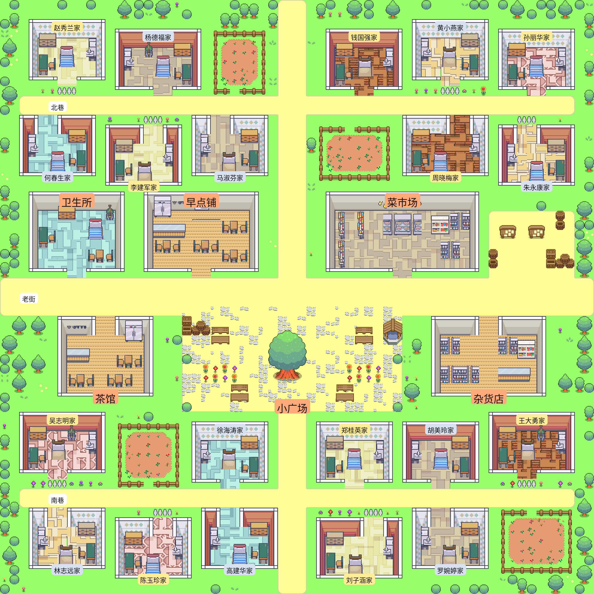

# 小镇场景说明

这是仿真用的场景:一张从零画的小镇地图,加 20 位居民。它只是测量平台的"布景",
居民的人设和作息里**不包含**任何待测消息。



图上黄底名字是核心 10 人的家,蓝灰底名字是 20 人对照组多出来的 10 人的家。

## 地图

- 大小:62 × 62 格(原渔村地图是 140 × 100 格,小镇面积不到它的三成,人更容易碰面)。
  10 人和 20 人实验用的是同一张地图。
- 布局照着真实小镇来:一条东西向的"老街"和一条南北向的街在镇中心交叉,交叉口南侧是小广场(中间一棵大榕树);
  店铺沿老街两侧面对面开门(北侧:卫生所、早点铺、菜市场和一小块露天集市;南侧:茶馆、杂货店)。
- 民居 20 户,分四排夹着"北巷"和"南巷",门都朝巷子开;房子大小、墙面、地板、朝向各不相同,前后错落,
  中间穿插四块带篱笆的菜地,镇子四周是一圈树林。
- 公共场所(每位居民都认识):

| 地点 | 里面有什么 | 谁每天会来 |
| --- | --- | --- |
| 小广场 | 大榕树下、长凳、花坛 | 所有人(晨练、傍晚散步) |
| 早点铺 | 早点铺柜台、早点铺桌椅、蒸笼灶台 | 所有人(吃早饭) |
| 菜市场 | 蔬菜摊、水果摊、熟食摊、鲜肉摊、干货摊、豆腐摊 | 几乎所有人(买菜) |
| 杂货店 | 杂货店柜台、杂货店货架、冷饮柜 | 部分人 |
| 茶馆 | 茶馆柜台、茶桌 | 部分人(下午喝茶下棋) |
| 卫生所 | 诊桌、病床、药柜、候诊椅 | 医生护士,偶尔有老人 |

- 每户民居一间屋,里面有床、书桌、灶台、衣柜。菜地、露天集市、树林只是摆设,不是可去的地点。每位居民只认识自己家和六个公共场所,
  不会去别人家串门,所以碰面都发生在公共场所和路上。

## 居民

核心 10 人(`data/town.json`,默认名单):

| 姓名 | 年龄 | 身份 |
| --- | --- | --- |
| 赵秀兰 | 54 | 早点铺老板 |
| 钱国强 | 47 | 菜市场蔬菜摊主 |
| 孙丽华 | 39 | 杂货店老板 |
| 李建军 | 61 | 茶馆老板 |
| 周晓梅 | 34 | 卫生所医生 |
| 吴志明 | 68 | 退休语文老师 |
| 郑桂英 | 72 | 退休纺织女工 |
| 王大勇 | 29 | 快递员 |
| 陈玉珍 | 45 | 裁缝(在家接活) |
| 刘子涵 | 24 | 在家开网店的年轻人 |

20 人对照组(`data/town_20.json`)在上面 10 人之外再加:

| 姓名 | 年龄 | 身份 |
| --- | --- | --- |
| 杨德福 | 58 | 菜市场熟食摊主 |
| 黄小燕 | 27 | 卫生所护士 |
| 何春生 | 50 | 茶馆伙计 |
| 马淑芬 | 65 | 退休会计,广场舞领头人 |
| 朱永康 | 70 | 退休机修工,爱下棋 |
| 徐海涛 | 36 | 货车司机 |
| 胡美玲 | 42 | 早点铺帮工 |
| 林志远 | 21 | 放假回家的大学生 |
| 高建华 | 53 | 在小广场摆摊的修鞋匠 |
| 罗婉婷 | 31 | 菜市场干货摊主 |

核心 10 人的人设里不提另外 10 人(10 人实验里他们不存在);核心 10 户的家均匀分散在四排民居里。

## 怎么跑

```
cd generative_agents
python start.py --name town-test --start "20250213-05:00" --step 10 --stride 10
```

默认读 `data/town.json`(10 人)。跑 20 人时,用 `--agents` 参数把 `data/town_20.json` 里的名字用逗号连起来传进去。

## 怎么改

- 居民的文字设定(性格、经历、作息):改 `generative_agents/data/town_residents.json`。
- 地图布局、家具、地点名:改 `generative_agents/build_town.py`。
- 改完在 `generative_agents/` 下运行 `python build_town.py --render`,它会重新生成
  地图文件、每位居民的 `agent.json`、两份名单和上面这张图,并自动检查每个地点都走得到。

说明:素材目录仍叫 `assets/village/`(启动脚本里写死了这个路径,另一个 PR 正在改启动脚本,
这里先不动);人物贴图沿用原项目的 20 套人物图。
